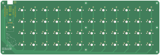
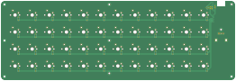

# 4x12_Keyboard_Rev2_KiCad
4x12 Ortholinear Keeb with RP2040

## Bill of Materials

| Reference(s) | Qty | Value | Footprint |
|---|---:|---|---|
| D1–D48 | 48 | 1N4148W | `Diode_SMD:D_SOD-123` |
| ENC1 | 1 | RotaryEncoder | `Rotary_Encoder:RotaryEncoder_Alps_EC12E_Vertical_H20mm` |
| LED1 | 1 | 3V | `LED_SMD:LED_0805_2012Metric_Pad1.15x1.40mm_HandSolder` |
| LED2 | 1 | 2.1 | `LED_SMD:LED_0805_2012Metric_Pad1.15x1.40mm_HandSolder` |
| Q1 | 1 | MMBT3904 | `Package_TO_SOT_SMD:SOT-23` |
| R1 | 1 | 100 | `Resistor_SMD:R_0805_2012Metric` |
| R2 | 1 | 1k | `Resistor_SMD:R_0805_2012Metric` |
| R3 | 1 | 330 | `Resistor_SMD:R_0805_2012Metric` |
| SW1–SW48 | 48 | SW_Push | `Keyboardparts:SW_Cherry_MX_1.00u_PCB_NoSilkScreen` |
| U1 | 1 | XIAO-RP2040-Plus-SMD | `Seeed_XIAO:XIAO-RP2040-Plus-SMD` |

### 5 PCBs cost roughly $60 USD from JLPCB, be sure to get a stencil as well for SMD diodes, 48 will get tedious and difficult even in the 0805 package. 
